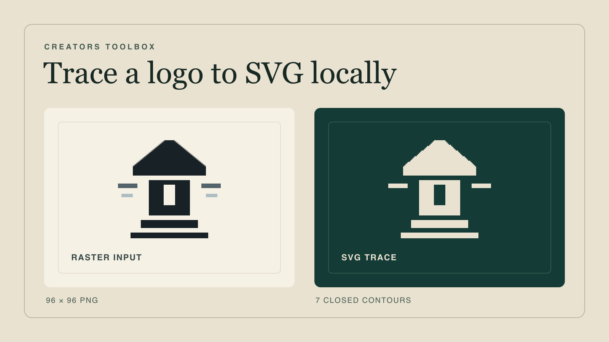

# Local SVG Tracer

Turn the dark silhouette in a flat raster logo into an editable SVG. The script uses FFmpeg to read one image frame and traces the marked pixels with Python. Everything runs on your computer.



## Run it

Put Python 3.9 or later and [FFmpeg](https://ffmpeg.org/download.html) on your PATH. Then run this from the repository folder.

```sh
python3 trace.py examples/beacon.png beacon.svg --threshold 150
```

The included beacon sample produces seven closed contours. The window in the middle stays transparent, and the paler decorative lines drop out. Try a cutoff of 220 to keep those lines.

```sh
python3 trace.py examples/beacon.png beacon-more-detail.svg --threshold 220
```

Open the SVG in your browser to check it on light and dark backgrounds, or import it into a vector editor to adjust the path. Pick a fresh output filename for each run. The script leaves existing files alone.

## How the trace works

The script reads the first frame and scales images larger than 1024 pixels on their longest edge to fit that limit. It composites transparency over white before applying the cutoff. For each dark region, it connects its exposed pixel edges, removes intermediate points along straight runs, and writes the closed contours into a single SVG path. Openings, such as the beacon window, use an even-odd fill rule.

Use high-contrast, dark-on-light marks. The SVG has a single fill color. Its line segments follow the pixel grid, so low-resolution diagonals can need cleanup at large sizes.

The code and demo artwork are MIT licensed. FFmpeg is installed separately and carries its own license.
